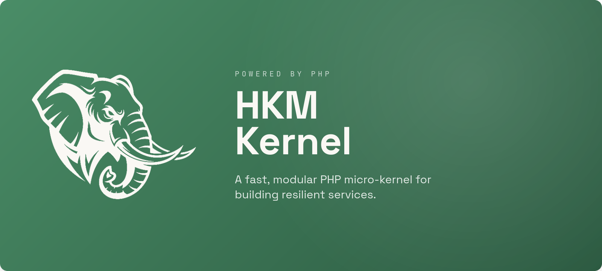

<p align="center">
  
</p>

<h1 align="center">HKM Kernel</h1>

<p align="center">
  <em>A modular <strong>PHP 8.4+</strong> service framework built on the <strong>Gated Demand Architecture (GDA)</strong>.<br>
  Security runs <em>before</em> any module loads, and only the modules a request actually needs are ever wired in.</em>
</p>

<p align="center">
  <a href="https://www.php.net/"></a>
  <a href="LICENSE"></a>
  
  
</p>

It ships as a **native cross-platform CLI** (`hkm`) built with Zig, so you install and
upgrade it like a Go/Rust binary — no Composer needed to get started.

---

## Table of contents

1. [Purpose](#purpose)
2. [What we're building toward](#what-were-building-toward)
3. [Project status — done vs. cooking](#project-status--done-vs-cooking)
4. [Why GDA?](#why-gda)
5. [Performance — measured](#performance--measured)
6. [Install](#install)
7. [The `hkm` CLI](#the-hkm-cli)
8. [Your first project](#your-first-project)
9. [Core concepts](#core-concepts)
10. [The request lifecycle](#the-request-lifecycle)
11. [Building a feature — end to end](#building-a-feature--end-to-end)
12. [The five access rules](#the-five-access-rules)
13. [Batteries included (plugins)](#batteries-included-plugins)
14. [Development from source](#development-from-source)
15. [Security defaults](#security-defaults)
16. [License](#license)

---

## Purpose

**HKM Kernel exists to make secure, cost-predictable PHP services the default — not the
reward for discipline.**

Most PHP frameworks boot the whole application, wire every service, and *then* decide what
the request needs. That is convenient, but it means an unauthenticated request that should
cost nothing still pays to construct half your app, and domain boundaries live only in your
head (and your code reviews).

HKM inverts that with the **Gated Demand Architecture**:

- **Security is the gate, not a middleware afterthought.** A `SecurityGateway` runs *before*
  any module is wired. A denied request costs *zero* module construction.
- **You pay only for what a route uses.** Modules are resolved from a per-request dependency
  graph and wired on demand. Nothing you didn't ask for is loaded.
- **Boundaries are enforced by the runtime, not by convention.** Cross-layer and
  cross-module access rules throw real exceptions, not lint warnings.

The goal is a framework where the *fast, secure, well-bounded* way to build something is also
the *easy* way — and where you can drop in a first-party plugin (auth, tenancy, mail, OAuth2)
without inheriting a monolith.

> **This is not Laravel, Symfony, or Slim.** It borrows none of their conventions — no
> globals, no facades, no runtime auto-discovery. Everything is explicit and injected.

---

## What we're building toward

The north-star goals that guide every decision in this repo:

| Goal | What it means |
|---|---|
| **Zero-cost denial** | A blocked request never constructs a module. Security is measured in the gateway, not the controller. |
| **Per-request minimalism** | The kernel wires exactly the modules a route needs — and their transitive dependencies — and nothing else. |
| **Runtime-enforced isolation** | One module, one domain. Modules cannot reach into each other's internals; the container throws if they try. |
| **A dependency-free kernel** | The core should carry no vendor coupling. Request/Response/uploads become pure value objects (see *cooking*, below). |
| **Infrastructure independence** | The kernel defines *ports*; the project supplies adapters (MySQL, Redis, S3, SMTP…). Swap them without touching domain code. |
| **Install like a binary** | `hkm` is a native cross-platform launcher — no Composer required to get started, upgradeable in place. |
| **Batteries, not a monolith** | Auth, Users, Tenancy, OAuth2, Mail, and more ship as opt-in first-party plugins, each owning exactly one domain. |

---

## Project status — done vs. cooking

> **Where things stand today.** HKM is under **active development**. The architecture and the
> core plugins are in daily use, and releases are cut regularly — but some subsystems are
> still stabilizing. This section is the honest map.

### ✅ Done & stable

- **The GDA kernel** — boot pipeline (10 fail-fast stages), security gateway, on-demand
  module loader, request-scoped DI with runtime scope enforcement, HTTP / CLI / Worker
  pipelines, domain + integration event system, and the port interfaces.
- **The five access rules**, enforced at runtime via `ModuleContainer::bindInternal()`.
- **Native distribution** — `hkm` launcher + `hkm-config` built with Zig; `.deb`, macOS
  `.app`, and Windows `.zip` bundles published automatically from `CHANGELOG.md`.
- **First-party plugins** (see [the full table](#batteries-included-plugins)) — Auth,
  User, Tenancy, OAuth2, Validation, Mail, Storage, Session/Cookie, HttpClient,
  SecurityFilters, I18n, View/ViteManifest/Pageflow.
- **Multi-project, multi-tenant hosting** — host-based `DomainResolver`, strict per-tenant
  DB routing, and a project-over-plugin resource resolution model.
- **Database & migrations** — the multi-driver `DatabasePort` (MySQL / PostgreSQL / SQLite /
  SQL Server) and the standalone **LetMigrate** engine (fluent schema, seeders, CLI).
- **Frontend federation** — per-project surfaces + `hkm ui` to mirror plugin UIs, with a
  Pageflow (Inertia-style) SPA bridge.

### 🍳 Still cooking

- **Dependency-free HTTP core.** The kernel's `Request`/`Response`/`UploadedFile` are
  *currently* built on `symfony/http-foundation` as a deliberate, temporary choice. They are
  being reimplemented as pure value objects so the kernel carries no vendor coupling. The
  kernel's own method surface (`$request->input()`, `Response::json()`, …) is the stable API —
  build against it and the switch will be non-breaking.
- **API surface hardening.** We're at the `1.0.x` line; some plugin contracts and config keys
  are still settling. Pin your version and read the [CHANGELOG](CHANGELOG.md) before upgrading.
- **Docs & guides.** The layer deep-dives in [`docs/guides/`](docs/guides/) are being expanded
  and turned into a proper documentation site.
- **Test & tooling coverage.** PHPStan (level 5) and the PHPUnit suite are wired as CI gates;
  coverage and static-analysis depth are still growing.

### 🗺️ On the roadmap

- Finish the dependency-free kernel and drop the transitional Symfony dependency.
- A public documentation site generated from the layer guides.
- More first-party adapters (queue backends, storage drivers, mail transports).
- Performance benchmarks published per release.

Found a gap or want to help? [Open an issue](https://github.com/AlfaCode-Team/hkm-kernel/issues)
or a discussion.

---

## Why GDA?

Most frameworks boot everything, then decide what to do. GDA inverts that:

| Principle | What it means in practice |
|---|---|
| **Security before everything** | A `SecurityGateway` runs before any module loads. A denied request costs *zero* module wiring. |
| **Load only what is needed** | Only the modules required for *this* route are registered — resolved from a dependency graph per request. |
| **One module, one domain** | Every module owns exactly one bounded business domain. No exceptions. |
| **Isolation by default** | Modules cannot touch each other's internals — request-scoped containers enforce this at **runtime**. |
| **Infrastructure independence** | The kernel defines *port* interfaces; the project supplies implementations (MySQL, Redis, S3, …). |
| **Explicit over implicit** | Everything is declared in `module.json`. Nothing is auto-discovered at runtime. |

The result: predictable performance (you pay only for what a route uses), strong domain
boundaries that hold at runtime, and infrastructure you can swap without touching business
code.

### The three worlds

```text
┌─────────────────────────────────────────────────┐
│  PROJECT LAYER   (wiring only — no business logic)│
│  ┌─────────────────────────────────────────────┐ │
│  │  MODULE / PLUGIN LAYER  (bounded domains)   │ │
│  │  ┌───────────────────────────────────────┐  │ │
│  │  │  KERNEL                               │  │ │
│  │  │  boot · security · loading · DI ·     │  │ │
│  │  │  pipelines · events · ports           │  │ │
│  │  └───────────────────────────────────────┘  │ │
│  └─────────────────────────────────────────────┘ │
└─────────────────────────────────────────────────┘
```

- **Kernel** — knows nothing about your domains. Changes rarely.
- **Module/Plugin** — knows nothing about the project. Wires to the kernel through contracts.
- **Project** — knows everything, contains no business logic. Pure wiring.

---

## Performance — measured

Every number below was measured on one machine — against a scaffolded project, and against a
complete application built on it (see *A real application, not a probe*). None is estimated,
and none is copied from a third party.

**Harness:** Apple M3 (8 cores, 16 GB), macOS 27.2, PHP 8.5.12 with OPcache
(`opcache.enable=1`), Swoole 6.2.5, nginx 1.31.8. Load generated with `ab -k -c 20 -n 4000`
after a 300-request warm-up, against a dedicated `php-fpm` master (`pm=static`, 4 children)
and a dedicated nginx on their own ports and logs. Swoole ran 4 workers. Run-to-run variance
is ±10–25% on a busy machine, so treat the **ordering** as solid and the absolute figures as
this laptop's.

### The same application on three SAPIs

Same routes, same `.env` — only the server differs.

| Server | small JSON `/ping` | DB route (SQLite) | serial latency (`-c 1`) |
|---|---|---|---|
| `php -S` built-in (1 process) | 609 req/s | 346 req/s | 2.6 ms |
| nginx + PHP-FPM (4 workers) | 1,591 req/s | 1,209 req/s | 2.6 ms |
| **Swoole (4 workers)** | **8,994 req/s** | **4,840 req/s** | **0.44 ms** |
| *raw PHP, no framework (FPM)* | *11,791 req/s* | — | *0.45 ms* |

**The serial number is the headline, not the throughput one.** With a resident kernel, HKM
answers a request in **0.44 ms** against **0.45 ms** for a bare PHP script with no framework
at all — the per-request cost of the framework is, within measurement error, nothing. The
5.7× gap between Swoole and PHP-FPM is almost entirely `Kernel::build()` running again on
every request.

`php -S` serves one request at a time. That row exists only to show why it must never be
used for a benchmark or a deployment.

### What configuration alone is worth on PHP-FPM

Same server, same code — only `.env` changed:

| Configuration | req/s | vs. shipped |
|---|---|---|
| As scaffolded (`APP_DEBUG=true`, no `BOOT_CACHE`) | 163 | 1.0× |
| `BOOT_CACHE=1` | 997 | 6.1× |
| `+ APP_ENV=production`, `APP_DEBUG=false`, `ENV_CACHE=1` | 1,542 | **9.4×** |

`BOOT_CACHE` is documented as ~86× on the compile step in isolation; **end to end it is 9.4×
on throughput.** A project deployed to PHP-FPM with the development defaults runs at roughly
a tenth of its capacity. Set all three on any FPM deployment, and clear
`var/cache/manifests/` on deploy.

### Against other frameworks

Identical conditions: the same nginx, the same `php-fpm` pool, the same one-route `/ping`
returning the same small JSON, each framework in its own production mode (Laravel
`artisan optimize`, Symfony `APP_ENV=prod` with a warmed cache).

| Framework | req/s | p50 | p99 |
|---|---|---|---|
| raw PHP (no framework) | 11,791 | 2 ms | 3 ms |
| **HKM 1.21 — Swoole** | **8,994** | 2 ms | 9 ms |
| Slim 4.15 — FPM | 5,299 | 4 ms | 5 ms |
| Symfony 8.1 — FPM | 2,470 | 8 ms | 14 ms |
| HKM 1.21 — FPM | 1,591 | 12 ms | 33 ms |
| Laravel 13.42 — FPM | 554 | 32 ms | 81 ms |

Read honestly, that says two different things:

- **Resident, HKM is the fastest full framework here** — 76% of raw PHP, 1.7× Slim (a
  micro-framework), 3.6× Symfony, 16× Laravel.
- **Per-request on FPM, HKM is mid-pack** — behind Symfony, ahead of Laravel. Symfony
  compiles its container and routing to PHP at build time; HKM re-reads its manifests,
  revalidates ports and security layers and boots every module on each request, and
  `BOOT_CACHE` shortens that without removing it.

Two caveats that matter before anyone quotes this table:

1. **It is not equal work.** HKM's `/ping` passes a WAF, a CSRF layer and a security gateway,
   and emits security headers. Slim's is a closure. That is a design difference, not overhead
   to be optimised away — but it is not like-for-like.
2. **Swoole vs. FPM is architecture, not merit.** Laravel Octane or Symfony with a persistent
   runtime would close most of that gap. Comparing HKM-on-Swoole with Laravel-on-FPM measures
   the deployment model, not the framework.

### Under load, on a route that waits

Every table above measures a route that returns a constant, which is the one case where
framework overhead is the whole request. Add 50 ms of I/O — one database call, one API call,
one queue push, i.e. **any real endpoint** — and run four workers on each target:

| Target (50 ms I/O, 4 workers) | c=4 | c=50 | c=200 |
|---|---|---|---|
| raw PHP — FPM | 76 | — | — |
| Slim 4.15 — FPM | — | 76 | — |
| Symfony 8.1 — FPM | — | 75 | — |
| **HKM 1.21 — FPM** | **70** | **70** | **refused** |
| Laravel 13.42 — FPM | — | 71 | — |
| **HKM 1.21 — Swoole + coroutine hooks** | **77** | **925** | **3,653** |

The arithmetic ceiling for four workers at 50 ms is 78 req/s, and every blocking
configuration sits on it. **The five frameworks that spanned 21× on `/ping` span 9% here** —
framework overhead is a fixed cost, so it matters in proportion to how little the handler
does. What changed throughput by 47× was the concurrency model, not the framework:
`enable_coroutine=true` alone buys nothing (the request runs in a coroutine, but a blocking
call still holds the worker), while `SWOOLE_HOOK_FLAGS=2147483647` serves 3,653 req/s at
concurrency 200 with p50 unchanged at 52 ms.

Two other measured limits worth knowing before a deploy:

- **PHP-FPM does not degrade past its pool — it refuses.** At c=200, 199,624 of 200,000
  responses were non-2xx in 2 ms: `kern.ipc.somaxconn` (128 here) caps the listen queue
  whatever `listen.backlog` says, and raising `pm.max_children` does not move it. Swoole at
  the same concurrency queued and kept serving.
- **Swoole's default `dispatch_mode = 2` pins a connection to a worker** by hashing its fd.
  Four keepalive connections landed on two of four workers — half the server idle, 38 of
  78 req/s. `dispatch_mode = 3` fixed it. This is exactly the shape of a reverse proxy's
  upstream pool.

### A real application, not a probe

Every number above is a route that returns a constant or sleeps. To measure what an
application does, a complete GDA plugin was built and benchmarked — not a controller with a
query in it, but the full shape the framework asks for:

| Layer | What it holds |
|---|---|
| `Domain/` | `Money` (integer cents), `Product` and `Order` entities with private constructors, named constructors and recorded domain events, an `OrderStatus` enum |
| `Application/` | `CatalogService` (cache-aside read), `CheckoutService` in the mandated transaction → collect → commit → dispatch shape, a validating `PlaceOrderDTO` |
| `Infrastructure/` | two repositories touching `DatabasePort` only, three controllers at ≤3 lines, an audit listener on the integration event, a queued `ReserveStockJob` |
| `module.json` | `solves: shop.catalog`, five routes with `filters` and per-route `requires`, `jobs[]`, `config[]` |

Backed by 500 seeded products, SQLite in WAL mode, Redis for cache and queue, and the
project's WAF + CSRF + security gateway in front of every request.

`POST /api/shop/orders` does all of this per request: validate a DTO → authorize against the
`Identity` → load the products → open a transaction → insert the order → insert its lines →
decrement stock with a guarded `UPDATE` → commit → dispatch an integration event → write an
audit row from a listener → push a job to Redis.

| Route (c=20) | FPM 4ch | FPM 32ch | Swoole 4w | Swoole 32w |
|---|---|---|---|---|
| `/ping` (no work) | 1,171 | 1,450 | 4,460 | **13,112** |
| catalogue read, 1 Redis `GET` | 996 | 1,081 | 1,888 | 2,887 |
| catalogue read, 2 SQL queries | 990 | 557 | 871 | 3,834 |
| server-rendered HTML + layout | 905 | 1,257 | 859 | 3,085 |
| uncached DB list (`/api/tasks`) | — | 1,191 | 1,374 | — |
| `POST /orders` (the chain above) | 515 | 385 | 286 | 578 |

Read the columns, not the rows. **At equal worker counts Swoole loses the HTML render and the
write** (859 vs 905, 286 vs 515): four resident workers are fewer parallel slots than four
FPM children plus the OS scheduler, once a request blocks on disk. Equalise at 32 and it wins
everything — 1.5× on the write, 9× on `/ping`. So the resident-kernel advantage is largest
where the framework is most of the request, and smallest where it is least of it.

**Worker count, not the framework, set every number here.** 4 → 32 children is worth 8.1× on
an I/O-bound route and costs 25% on the write path, where 32 processes contend for 8 cores and
one SQLite writer. Size the pool from the workload.

**The Redis cache made the catalogue read slower** — the opposite of the usual advice, so it
was priced directly: one local Redis round trip is 167–239 µs (floor 145 µs), the two SQLite
queries it replaced are 129 µs. Under a resident runtime the uncached route won both passes.
A cache is a bet that the thing behind it is expensive; check before taking it. (An earlier
version called `has()` then `remember()` — two round trips, 267–279 µs — which turns a small
win into a clear loss. One `get()` per hit.)

**Correctness held exactly under load**, which matters more than the throughput: 2,602 orders
produced 5,203 line rows, the queue's jobs wrote 5,203 reservation rows, the event listener
wrote 2,602 audit rows, and the queue drained to zero. Every job ran once; nothing was lost or
duplicated.

> **These routes exist only in HKM, so this table is not a framework comparison.** The
> cross-framework numbers are the `/ping` and 50 ms rows above: resident, HKM is the fastest
> full framework measured; on an I/O-bound route all five land within 9% of each other; and
> per-request on PHP-FPM with cheap routes, HKM is behind Symfony, whose container and routes
> are compiled at build time.

### Workers

File-backed queue (`FileQueue`), with a job that reads from SQLite through `DatabasePort`:

| | rate |
|---|---|
| enqueue | ~20,000 jobs/s |
| drain (500-job batch) | 2,558 jobs/s |
| drain (2,000-job batch) | 1,902 jobs/s |

The queue drained to zero on every run. Throughput falls as the batch grows because
`FileQueue` rewrites the whole file on each pop — fine for development, quadratic overall.
A Redis queue is O(1) per pop.

A job that does real work — two inserts, through a Redis queue, with its own
`ModuleContainer` — runs **7–9× slower than that**: 269 jobs/s on one worker, 715 on four
(sub-linear, because the SQLite writer serialises). Plan a queue against the second number,
not the first.

> **Bind the queue in `withPorts()`, not only in a module.** `WorkerLoop` resolves
> `QueuePort` from the `CoreContainer`, because it needs a queue *before* it has a job to
> build a module container for. A plugin that binds `QueuePort` per request is invisible to
> the worker: HTTP pushes to the broker, the worker pops from the core binding, and it prints
> `Remaining in 'default': 0` while every job sits in the broker. Nothing throws. Measured,
> and the project template now says so where the binding lives.

---

## Install

Download the latest build from
[Releases](https://github.com/AlfaCode-Team/hkm-kernel/releases/latest).

**Linux (Debian / Ubuntu / Kali)**
```bash
sudo apt install ./hkm-kernel_<version>_amd64.deb
hkm doctor        # verify PHP + extensions
```

**macOS (Homebrew)** — the shortest path; `php` and `composer` come with it.
```bash
brew tap alfacode-team/hkm https://github.com/AlfaCode-Team/hkm-kernel
brew trust alfacode-team/hkm
brew install hkm
hkm doctor
```
`brew trust` is not optional. Homebrew 6 refuses to load a formula from a
third-party tap until you say you trust it, and it refuses at `brew install`
rather than at `brew tap` — so without that line the tap appears to succeed and
the install then fails with *"Refusing to load formula … from untrusted tap"*.

**macOS (installer)** — no root, like the Linux installer: `HKM.app` goes to
`~/Applications`, the Gatekeeper quarantine flag is cleared, and `hkm` /
`hkm-config` land on your `PATH`. Nothing is written outside your home.
```bash
curl -fsSL https://github.com/AlfaCode-Team/hkm-kernel/releases/latest/download/install-macos.sh | sh
```
Add `--system` for a machine-wide `/Applications` install — that is the only
path that asks for sudo. An install that already exists is updated where it is,
so re-running never leaves a stale copy shadowed by a new one.

**macOS (manual)** — extract `hkm-kernel-<version>-macos-universal.tar.gz`
wherever you want it, then run
`HKM.app/Contents/Resources/opt/hkm-kernel/install.sh`. The launcher
self-locates its kernel, so the bundle works from any directory.

**Windows** — extract `hkm-kernel-<version>-windows-x86_64.zip`, run
`hkm-kernel\install.bat`, and add the folder to `PATH`.

The launcher **self-locates** the kernel — no environment variables required on a standard
install. Runtime PHP dependencies are resolved with Composer on the target at install time,
so they match your exact PHP.

The Homebrew formula lives in this repository under [`HomebrewFormula/`](HomebrewFormula/hkm.rb),
which is why the tap URL is the repo itself rather than a separate `homebrew-hkm`. It keeps the
project registry in `~/.local/share/hkm` rather than inside the Cellar, so `brew upgrade` cannot
take your registered projects with it.

### Requirements (verified by `hkm doctor`)

- PHP **≥ 8.4.1**
- Extensions: `json, mbstring, ctype, tokenizer, filter, pdo, openssl, curl, fileinfo`
- At least one PDO driver: `mysql` · `pgsql` · `sqlite` · `sqlsrv`
- Optional: `redis`, `swoole`/`openswoole`, `gd`, `intl`

---

## The `hkm` CLI

| Command | Purpose |
|---|---|
| `hkm new <path> [--project=<name>]` | Scaffold a new project (secure defaults: `.env` chmod 600, Apache **+** nginx configs) |
| `hkm run [path\|name]` | Run a project locally (PHP dev server) |
| `hkm cli [command]` | Run a project's console interactively |
| `hkm worker [args]` | Run a project's queue worker |
| `hkm list` | List registered projects |
| `hkm plugins [path\|name]` | Analyse a project's enabled plugins/modules |
| `hkm module` | Inspect / update the first-party kernel packages |
| `hkm ui [sync\|list\|link\|clean]` | Federate enabled plugins' UIs into the frontend |
| `hkm doctor` | Diagnose PHP, extensions, and the resolved kernel path |
| `hkm-config` | Set up / repair the full environment (kernel + userdata) |
| `hkm upgrade [--check]` | Check for and install a newer release |
| `hkm version` / `--version` / `-v` | Show the banner + version |
| `hkm <command> --dev` | Run any command against the **development** kernel checkout |

### Environment (all auto-detected — override only for non-standard layouts)

| Variable | Meaning |
|---|---|
| `HKM_KERNEL_HOME` | Kernel root (`composer.json`, `vendor/`, `projects/`, `templates/`) |
| `HKM_DEV_HOME` | Development kernel checkout used by `--dev` (`hkm-config set-dev-home <path>`) |
| `HKM_USERDATA_DIR` | Persistent registry (`projects.json` + `platform.json`) that **survives updates** |
| `HKM_PHP_BIN` | Override the `php` binary |
| `HKM_CLI_PATH` / `HKM_GLOBAL_AUTOLOAD` | Override the PHP CLI script / kernel autoload |

Run `hkm-config` once and it pins `HKM_KERNEL_HOME` and provisions a persistent
`HKM_USERDATA_DIR` (migrating any existing registry) into `~/.config/hkm/config.env`.

---

## Your first project

```bash
# 1. Scaffold — creates a hardened project skeleton
hkm new ~/apps/shop --project=shop

# 2. Verify the environment
hkm doctor

# 3. Run it locally
hkm run shop
#   → serving http://127.0.0.1:8000  (docroot pinned to app/public)

# 4. Console + queue worker for the same project
hkm cli shop migrate            # run migrations (LetMigrate)
hkm worker shop                 # drain the job queue
```

A project is **wiring only**. Its bootstrap composes the kernel from a shared base and
declares which plugins it activates:

```php
// projects/shop/bootstrap/app.php
/** @var Kernel $builder */
$builder = require __DIR__ . '/../../../app/bootstrap/base.php';

return $builder
    ->withProjectPath(dirname(__DIR__))
    ->withModules([
        Plugins\Auth\Provider::class,
        Plugins\User\Provider::class,
        Plugins\Task\Provider::class,
    ])
    ->build();
```

Incoming requests are mapped to a project by **host** (`app.example.com` → the `shop`
project) via `DomainResolver`, falling back to the `HKM_PROJECT` env var, then `admin`.

---

## Core concepts

### Modules & plugins

A **plugin** (local business module) lives under `plugins/<Name>/`, uses the `Plugins\<Name>\`
namespace, and follows a strict GDA folder layout:

```
plugins/Invoice/
├── module.json                              ← single source of truth
├── API/Contracts/InvoiceServiceContract.php ← the ONLY thing other modules may import
├── Domain/                                  ← entities, value objects, domain events (zero external imports)
├── Application/Services/InvoiceService.php  ← transaction + event orchestration
├── Infrastructure/
│   ├── Persistence/InvoiceRepository.php    ← DatabasePort only
│   ├── Gateways/StripeGateway.php           ← vendor SDK only
│   └── Http/Controllers/InvoiceController.php ← ≤3-line actions
└── Provider.php                             ← implements ModuleContract
```

### `module.json` — the single source of truth

Routes, config, dependencies, and emitted events are **declared**, never discovered:

```json
{
  "name": "invoice",
  "solves": "invoice.generation",
  "type": "module",
  "requires": ["database.query"],
  "exposes": ["InvoiceServiceContract"],
  "routes": [
    { "method": "GET",  "path": "/api/invoices",      "handler": "InvoiceController@index" },
    { "method": "POST", "path": "/api/invoices",      "handler": "InvoiceController@create", "filters": ["auth", "throttle:60,1"] },
    { "method": "GET",  "path": "/api/invoices/{id}", "handler": "InvoiceController@show" }
  ],
  "emits": ["invoice.created", "invoice.paid"],
  "config": ["INVOICE_CURRENCY", { "key": "INVOICE_TAX_RATE", "type": "float", "required": false }]
}
```

If a module reads an env var that isn't in `config[]`, **boot fails** — no silent misconfig.

### Ports (infrastructure independence)

The kernel defines interfaces; the project binds implementations once, at the app-lifetime
container:

```php
->withPorts([
    DatabasePort::class => new MySQLAdapter(config('database')),
    CachePort::class    => new RedisAdapter(config('cache')),
    QueuePort::class    => new RedisQueueAdapter(config('jobs')),
    MailPort::class     => new SmtpMailAdapter(config('mail')),
    StoragePort::class  => new S3StorageAdapter(config('storage')),
])
```

Swap MySQL for Postgres, or SMTP for SES, without touching a single line of domain code.

---

## The request lifecycle

```text
Request
  │
  ▼  SecurityGateway  (runs BEFORE any module loads)
  │   Firewall → RateLimiter → CSRF → [your Auth layer]   ── deny = zero module cost
  ▼
HTTP pipeline
  1. CorrelationIdStage   propagate X-Correlation-ID
  2. SecurityStage        run the gateway, attach Identity
  3. ResolveStage         route-manifest lookup → service name
  4. LoadStage            build dependency graph → wire ONLY those modules
     ↳ RouteFilterStage   run the route's declared filters[] (auth, throttle, …)
  5. ExecuteStage         contract → DTO → controller → Response
  6. ErrorStage (wraps all) classify → notify (Slack/Mail/DB/File) → HTTP response
```

Every stage is `handle(Request $request, callable $next): Response`. Modules add
cross-cutting behaviour by registering hooks in `Provider::boot()`, or opt individual routes
into named **filters** via `module.json`.

---

## Building a feature — end to end

A complete vertical slice. Each layer has one job and may only talk to the layer below it.

### 1. Domain — pure, zero external imports

```php
// Domain/ValueObjects/Money.php
final readonly class Money
{
    private function __construct(private int $amount, private string $currency) {   // integer cents — NEVER float
        if ($this->amount < 0) throw new \DomainException('Money cannot be negative');
    }
    public static function of(int|float $amount, string $currency): self {
        return new self((int) round($amount * 100), strtoupper($currency));
    }
    public function add(self $o): self {
        if ($this->currency !== $o->currency) throw new \DomainException('Currency mismatch');
        return new self($this->amount + $o->amount, $this->currency);   // operations return NEW instances
    }
    public function amount(): int { return $this->amount; }
}
```

### 2. Service — transaction + event orchestration (the mandatory shape)

```php
final class InvoiceService implements InvoiceServiceContract
{
    public function __construct(
        private readonly InvoiceRepository    $repository,
        private readonly TransactionManager   $transaction,
        private readonly DomainEventCollector $collector,
        private readonly EventBus             $eventBus,
        private readonly Identity             $identity,     // from the SecurityGateway
    ) {}

    public function create(CreateInvoiceDTO $dto): InvoiceResponseDTO
    {
        // authorization first
        if (!$this->identity->hasPermission('invoice:create')) {
            throw new ServiceException('invoice.unauthorized', layer: 'service.invoice');
        }

        $this->collector->beginCollection();
        $this->transaction->begin();
        try {
            $invoice = Invoice::create(ClientId::from($dto->clientId), Money::of($dto->amount, 'USD'));
            foreach ($invoice->releaseEvents() as $e) $this->collector->collect($e);
            $this->repository->save($invoice);
            $this->transaction->commit();
        } catch (\Throwable $e) {
            $this->transaction->rollback();
            $this->collector->discard();                     // ALWAYS — no phantom events on rollback
            throw new ServiceException('invoice.create.failed', layer: 'service.invoice', previous: $e);
        }

        // integration events dispatch ONLY after a successful commit — never inside try{}
        $this->eventBus->dispatch(new InvoiceCreatedIntegrationEvent($invoice->id()->value(), $dto->amount));

        return InvoiceResponseDTO::from($invoice);
    }
}
```

### 3. Repository — `DatabasePort` only, translate every `\PDOException`

```php
final class InvoiceRepository
{
    public function __construct(private readonly DatabasePort $db, private readonly Identity $identity) {}

    public function find(string $id): Invoice
    {
        try {
            $row = $this->db->queryOne(
                'SELECT * FROM invoices WHERE id = :id AND tenant_id = :t AND deleted_at IS NULL',
                ['id' => $id, 't' => $this->identity->tenantId],     // ALWAYS tenant-scoped
            );
        } catch (\PDOException $e) {
            throw new RepositoryException("find invoice [$id]", layer: 'repository.invoice', previous: $e);
        }
        return $row ? InvoiceHydrator::hydrate($row) : throw new RepositoryException("Invoice [$id] not found");
    }
}
```

### 4. Controller — ≤3 lines: DTO → service → Response

```php
final class InvoiceController
{
    public function __construct(private readonly InvoiceServiceContract $service) {}   // contract only

    public function create(Request $request): Response
    {
        $dto = CreateInvoiceDTO::fromRequest($request);   // validation happens here
        return Response::json($this->service->create($dto)->toArray(), 201);
    }
}
```

### 5. Provider — wire it together

```php
class Provider implements ModuleContract
{
    public function solves(): string  { return 'invoice.generation'; }
    public function requires(): array { return [DatabasePort::class]; }
    public function exposes(): array  { return [InvoiceServiceContract::class]; }

    public function register(ModuleContainer $c): void
    {
        $c->bindInternal(InvoiceRepository::class, fn($c) =>
            new InvoiceRepository($c->make(DatabasePort::class), $c->make(Identity::class)));

        $c->bind(InvoiceServiceContract::class, fn($c) => new InvoiceService(
            $c->make(InvoiceRepository::class), $c->make(TransactionManager::class),
            $c->make(DomainEventCollector::class), $c->make(EventBus::class), $c->make(Identity::class),
        ));
    }

    public function boot(HttpPipeline $http, CliPipeline $cli, WorkerPipeline $worker, EventBus $events): void
    {
        // $events->subscribe('payment.succeeded', MarkInvoicePaidListener::class);
    }
}
```

Add `Plugins\Invoice\Provider::class` to a project's `withModules([...])` and the routes,
config validation, and DI are live.

### Testing — always fakes, never real infrastructure

```php
$sut = new InvoiceService(
    new InMemoryInvoiceRepository(), new FakeTransactionManager(),
    new DomainEventCollector(), $bus = new FakeIntegrationEventBus(), Identity::asUser('u-1', 'tenant-a'),
);
$result = $sut->create($validDto);

$bus->assertDispatched(InvoiceCreatedIntegrationEvent::class, times: 1);
$this->assertNotNull($result->invoiceId);
```

---

## The five access rules

These are **enforced at runtime** by `ModuleContainer::bindInternal()` — a violation throws
`ScopeViolationException`, not a lint warning.

```text
Controller  →  Service      (published contract interface ONLY)
Service     →  Repository AND Gateway   (the ONLY layer that may call both)
Repository  →  DatabasePort ONLY        (no HTTP, no vendor SDK)
Gateway     →  Vendor SDK ONLY          (no DB, no services)
Domain      →  NOTHING EXTERNAL         (zero imports outside Domain/)
```

**Never** (a partial list the framework actively rejects):
- Routes defined in PHP — only in `module.json` / `proj.json`.
- `float` for money — use a `Money` value object with integer cents.
- Vendor exceptions (`\PDOException`, Stripe, …) escaping their layer — translate them.
- Integration events dispatched inside a `try{}` — only after commit.
- Another module's internal class imported — use its published contract.
- `getenv()` for a `.env` value — use the `env()` helper.
- Business logic in a controller — max 3 lines.

---

## Batteries included (plugins)

The kernel ships **no** plugins and depends on none. Roughly thirty first-party
plugins cover auth, users, tenancy, OAuth2, mail, storage, sessions, validation,
i18n, templating and the SPA bridge — each its own package, owning exactly one
domain.

```bash
hkm plugins domains      # every plugin and the `solves` domain it claims
hkm plugins enable auth  # install it, publish its assets, run its migrations
```

Then add its `Provider` to the project bootstrap's `withModules([...])`.

**Each plugin documents itself in its own repository** — `README.md` for what it
is, `CLAUDE.md` for its contract and configuration, and `module.json` as the
authoritative `requires[]` / `exposes[]` / `config[]`. This repository keeps no
plugin catalogue: a static list here is the copy that goes stale, and it did.
Repositories are at `github.com/AlfaCode-Team/hkm-plugin-<name>`.

---


## Development from source

```bash
git clone --recurse-submodules git@github.com:AlfaCode-Team/hkm-kernel.git
cd hkm-kernel
composer install                           # also wires the git hooks (core.hooksPath=.githooks)
vendor/bin/phpunit                         # run the test suite

# If you skip composer, enable the repo git hooks manually (strips AI co-author
# trailers from commit messages):
git config core.hooksPath .githooks

# Build the native launcher (needs Zig — see tools/.zig-version):
cd tools && zig build --release=small      # → ../bin/hkm + ../bin/hkm-config
```

### Building release bundles

```bash
VERSION=1.2.3 ./tools/bundle.sh all         # .deb + macOS .app + Windows .zip → dist/
# MODULES=git ./tools/bundle.sh linux       # fetch path-repo modules from pinned commits
```

Releases are cut by pushing a `v*` tag — CI runs the test suite first, then builds all three
OS bundles and publishes them automatically.

### Releasing (branch model + automation)

Development happens on the **`master`** dev branch; **`main`** is the stable release branch.
Releases are **CHANGELOG-driven and automatic** — you never tag by hand.

1. Do your work on `master` and commit.
2. Add a new `## [x.y.z] - YYYY-MM-DD` section to [`CHANGELOG.md`](CHANGELOG.md)
   (below `## [Unreleased]`), describing the changes.
3. Open a PR `master` → `main` and merge it.
4. On merge, the **Auto Release** workflow ([`.github/workflows/auto-release.yml`](.github/workflows/auto-release.yml))
   reads the top CHANGELOG version and, if no `vX.Y.Z` tag exists yet, creates the tag and
   calls the **Release** workflow — which runs the test gate, builds all OS bundles, and
   publishes the GitHub Release (notes pulled from that CHANGELOG section).

Notes:
- A release only starts when the merge changes `CHANGELOG.md` **and** introduces a version
  not already tagged — ordinary merges don't publish anything.
- No secret/PAT is required: Auto Release invokes the Release workflow directly via
  `workflow_call`.
- You can still cut a release manually at any time by pushing a `v*` tag.

For deep dives, see the layer guides in [`docs/guides/`](docs/guides/) and the
[CHANGELOG](CHANGELOG.md). Those guides cover the kernel (`src/`) and the packages
it runs on (`modules/`); the `Project\` layer is documented in
[hkm-project-layer](https://github.com/AlfaCode-Team/hkm-project-layer), each
plugin in its own repository, and the `hkm` CLI in [`tools/`](tools/README.md).

---

## Security defaults

Scaffolded projects are hardened out of the box:

- `.env` is `chmod 600`; debug output is force-disabled when `APP_ENV=production`.
- Every project ships `app/public/.htaccess`, and its nginx or Apache configuration is
  generated by the Edge plugin (`hkm edge:apply`) — the docroot pinned to `app/public`,
  dotfiles denied, and baseline security headers added.
- The `SecurityGateway` (firewall → rate limiter → CSRF → your auth layer) runs before any
  module — denied requests never touch business code.
- Keep secrets (`APP_KEY`, JWT signing keys, DB credentials) out of the CLI config and,
  in production, behind a `SECRETS_PROVIDER`.

---

## License

MIT — see [LICENSE](LICENSE).
